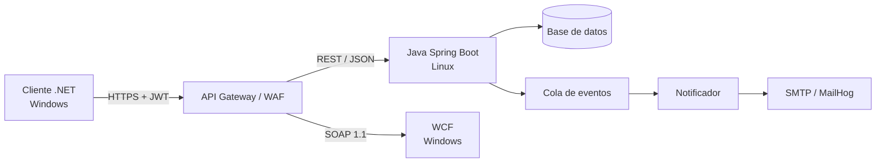
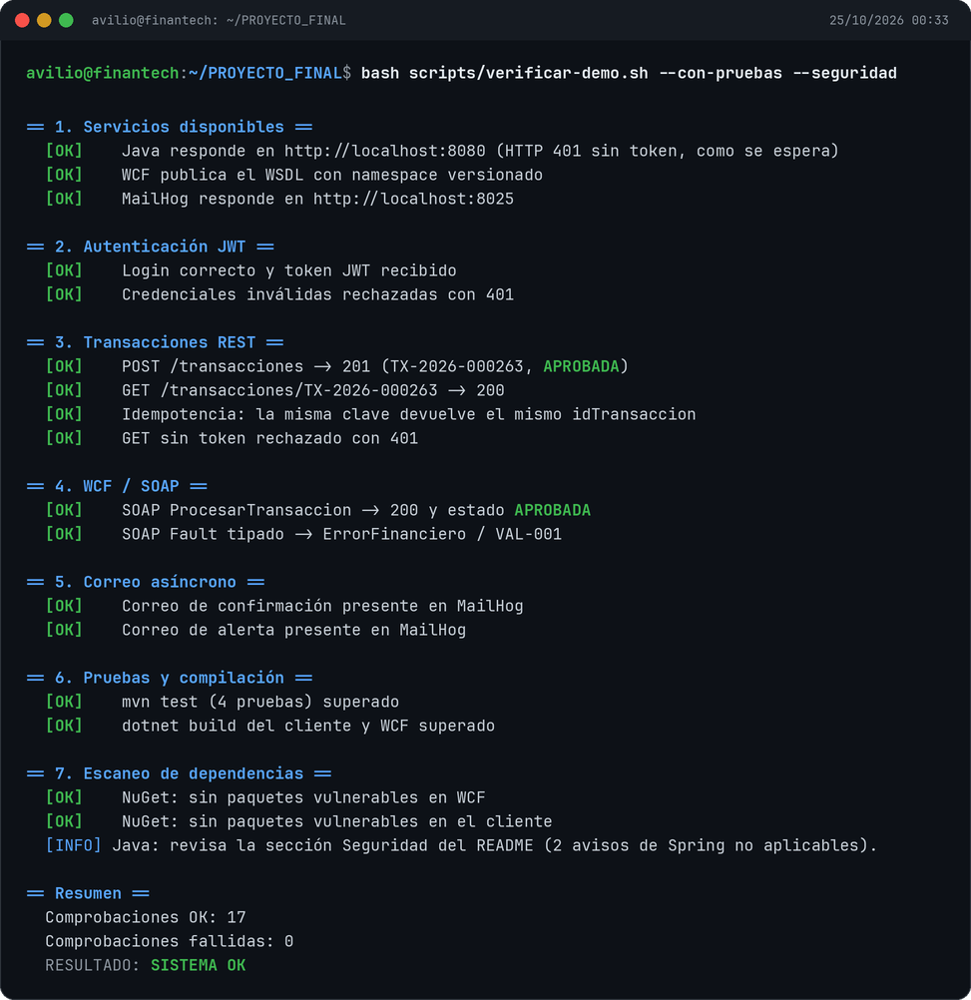
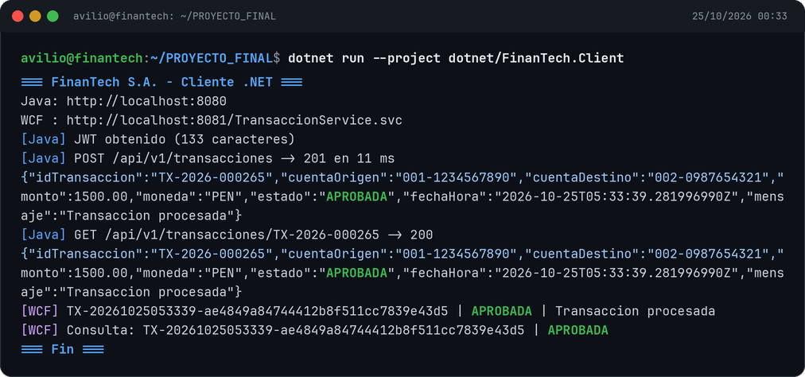
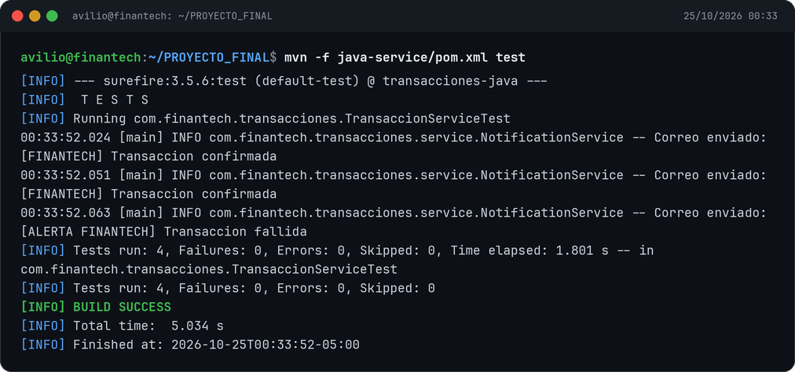
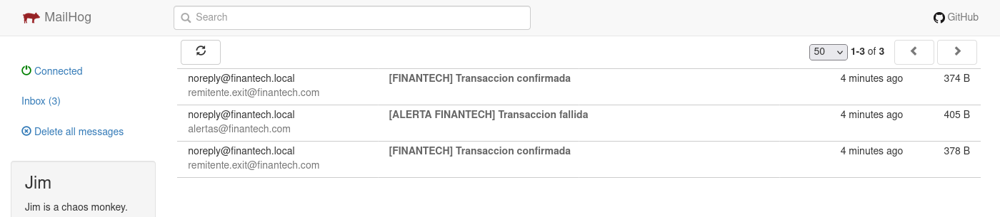
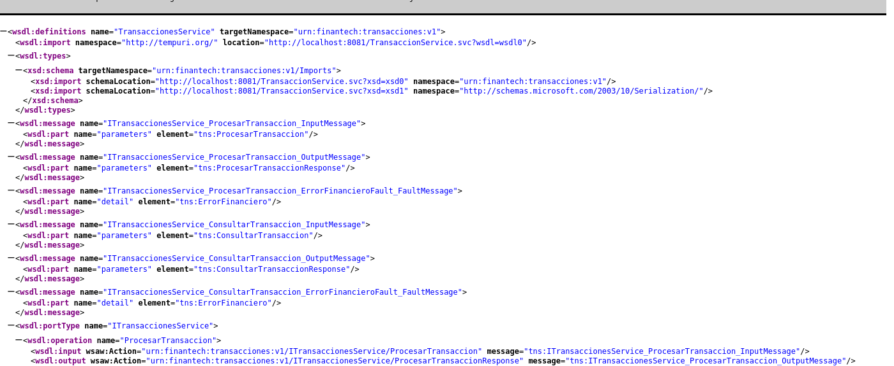

# FinanTech S.A. - Interoperabilidad .NET-Java

Propuesta y demo funcional para el trabajo final del curso **Servicios Web (PDSD-643)**.

Repositorio: <https://github.com/AvilioFT/finantech-interoperabilidad>

El objetivo es conectar el core financiero en **Java/Linux** con componentes **.NET/Windows**, usando **WCF**, **JSON**, **JWT** y **TLS**, reduciendo la latencia a menos de **200 ms p95**, automatizando alertas por correo y permitiendo una migración gradual sin detener las 50 000 operaciones diarias.

## Arquitectura

Cliente .NET/Windows -> API Gateway (TLS + JWT) -> servicio Java REST/JSON en Linux y servicio WCF en Windows -> base de datos, caché y cola de eventos -> notificador asíncrono de correo.



Diagramas exportados:

- [Diagrama de propuesta completo](docs/evidencias/diagramas/diagrama-propuesta-finantech.png) (arquitectura + fases de migración).
- [Arquitectura en capas](docs/evidencias/diagramas/diagrama-arquitectura-finantech.png).
- [Fases Strangler Fig](docs/evidencias/diagramas/diagrama-migracion-finantech.png).
- Fuentes Graphviz en [`docs/evidencias/diagramas/fuentes/`](docs/evidencias/diagramas/fuentes/).

## Demo funcional

| Componente | Ruta | Estado |
|---|---|---|
| Servicio Java (Spring Boot 3.5, JWT, transacciones, idempotencia, correo asíncrono) | [`java-service/`](java-service/) | Funcionando y con pruebas (`mvn test`: 4/4). |
| Servicio WCF (CoreWCF 1.9 sobre .NET 8, `basicHttpBinding`) | [`dotnet/FinanTech.WcfService.CoreWcf/`](dotnet/FinanTech.WcfService.CoreWcf/) | WSDL publicado y operación SOAP validada. |
| Cliente .NET (Java JSON + WCF SOAP) | [`dotnet/FinanTech.Client/`](dotnet/FinanTech.Client/) | Ejecuta el flujo completo. |
| Evidencias reales | [`docs/evidencias/`](docs/evidencias/) | JSON, WSDL, fault SOAP, correo y latencia. |
| Formato oficial rellenado | Entregable local (`.docx` / PDF), no versionado en Git | Completo salvo datos personales. |

## Cómo ejecutar la demo

```bash
# 1. Java (JDK 17+ y Maven)
mvn -f java-service/pom.xml spring-boot:run

# 2. WCF CoreWCF (.NET 8)
dotnet run --project dotnet/FinanTech.WcfService.CoreWcf

# 3. Cliente .NET
dotnet run --project dotnet/FinanTech.Client

# 4. MailHog (opcional, para ver los correos)
docker run --rm -d --name mailhog -p 1025:1025 -p 8025:8025 mailhog/mailhog
```

Credenciales de la demo: usuario `cliente`, contraseña `Clave123!` (configurables con `DEMO_USER` y `DEMO_PASSWORD`). La bandeja de MailHog queda en <http://localhost:8025>.

## Verificación automática

Con los tres servicios levantados:

```bash
bash scripts/verificar-demo.sh
```

Comprueba disponibilidad, login JWT, rechazo 401, POST 201, GET 200, idempotencia, WSDL, SOAP correcto, SOAP Fault tipado y los dos correos en MailHog. Para incluir pruebas y escaneo de dependencias:

```bash
bash scripts/verificar-demo.sh --con-pruebas --seguridad
```

Salida esperada: `RESULTADO: SISTEMA OK` y `0` comprobaciones fallidas. Si `mvn` o `dotnet` no están en el `PATH`, define `MVN_BIN` y `DOTNET_BIN` con la ruta absoluta a cada ejecutable para que no se omitan las pruebas.

## Capturas de la demo

Tomadas el 25/10/2026 con Java (8080), WCF (8081) y MailHog (8025) en localhost. Las capturas de terminal muestran la salida real de los comandos.

| Verificación automática (17/17) | Cliente .NET (Java + WCF) |
|---|---|
|  |  |

| Pruebas Java (4/4) | Bandeja de MailHog |
|---|---|
|  |  |

**WSDL publicado por WCF** con namespace `urn:finantech:transacciones:v1`:



## Resultados de latencia

Medición real en localhost con el build final (25/10/2026):

| Métrica | Valor |
|---|---:|
| Iteraciones | 200 (+50 de calentamiento) |
| p50 | 13.13 ms |
| p95 | 20.63 ms |
| p99 | 25.35 ms |
| Promedio | 13.95 ms |
| Error rate | 0.00 % |

Condiciones: Linux x86_64, OpenJDK 21.0.13 (compilado con `--release 17`), Spring Boot 3.5.16, H2 en memoria, HTTP sin TLS. **No incluye** red real, TLS ni gateway; el SLO de <200 ms debe validarse con JMeter en un entorno representativo. Reporte completo: [`docs/evidencias/latencia/resultado.json`](docs/evidencias/latencia/resultado.json).

## Seguridad

Última revisión: 25/10/2026.

- **.NET:** sin paquetes vulnerables. Se fijaron `System.Security.Cryptography.Pkcs` 8.0.2 y `System.Security.Cryptography.Xml` 8.0.5.
- **Java:** Spring Boot 3.5.16, Tomcat 10.1.61, Jackson 2.21.8, Log4j 2.25.5, Logback 1.5.34 y H2 2.3.232.
- Quedan **dos avisos de Spring Framework 6.2.19** que **no aplican** a esta demo: uno afecta a Server-Sent Events con fragmentos y otro a `XsltView`; el servicio solo expone JSON y no usa SSE ni XSLT. Están corregidos en Spring Framework 7 / Spring Boot 4, migración recomendada para producción.
- La consola H2 está deshabilitada por defecto (`H2_CONSOLE_ENABLED=false`), `show-sql` está apagado y el correo usa un pool acotado de 2–4 hilos.
- Riesgos aceptados solo en la demo: HTTP sin TLS, JWT HS256 con secreto compartido, credenciales demo, H2 en memoria y MailHog sin autenticación. En producción: TLS 1.3, RS256/JWKS, identidad corporativa, PostgreSQL/SQL Server, rate limiting, mTLS y gestor de secretos.
- Dependabot, alertas de vulnerabilidades, secret scanning y push protection están activados.

## Evidencias

- [Login y token JWT](docs/evidencias/java/login-token.json)
- [POST 201](docs/evidencias/java/post-transaccion-201.json)
- [GET 200](docs/evidencias/java/get-transaccion-200.json)
- [Idempotencia](docs/evidencias/java/idempotencia.json)
- [Rechazo 401](docs/evidencias/java/login-invalido-401.json)
- [WSDL](docs/evidencias/wcf/wsdl.xml)
- [SOAP Fault tipado](docs/evidencias/wcf/soap-fault-monto-cero.xml)
- [Cliente .NET ejecutando](docs/evidencias/dotnet/cliente-ejecutando.txt)
- [Correos en MailHog](docs/evidencias/correo/mailhog-mensajes.json)
- [Latencia: resultado](docs/evidencias/latencia/resultado.json) · [resumen](docs/evidencias/latencia/resumen.txt) · [tiempos](docs/evidencias/latencia/tiempos.csv)
- [Capturas de la demo](docs/evidencias/capturas/)
- [Ejemplos JSON](docs/ejemplos/)

## Estructura del repositorio

```text
.
├─ AGENTS.md
├─ README.md
├─ .github/dependabot.yml
├─ docker-compose.yml
├─ docs/
│  ├─ ejemplos/                 JSON de ejemplo
│  └─ evidencias/               JSON, XML, CSV, PNG y fuentes Graphviz
├─ java-service/                Spring Boot 3.5 + JDK 17
├─ dotnet/
│  ├─ FinanTech.WcfService.CoreWcf/
│  └─ FinanTech.Client/
└─ scripts/
   ├─ verificar-demo.sh
   └─ prueba-latencia.ps1
```

## Estado

- [x] Análisis del caso práctico.
- [x] Arquitectura y respuestas a las preguntas guía.
- [x] Servicio Java con JWT, transacciones, idempotencia y correo.
- [x] Servicio WCF con WSDL y FaultContract.
- [x] Cliente .NET consumiendo Java y WCF.
- [x] Pruebas, evidencias y latencia p50/p95/p99.
- [x] Verificación automática (`scripts/verificar-demo.sh`).
- [x] Revisión de dependencias y endurecimiento de la demo.
- [x] Capturas de la demo (verificación, cliente .NET, pruebas, MailHog y WSDL).
- [ ] Completar datos personales en el formato `.docx`.
- [ ] Exportar el documento a PDF y armar el ZIP de entrega.

> La latencia de localhost no representa la red real. El objetivo de <200 ms se documenta como SLO y se mide con JMeter; no se deben inventar resultados.

## Documentación

La documentación extensa (plan de 4 días, arquitectura detallada, guía de implementación, documento final y guion de defensa) se mantiene **local** y no se publica en este repositorio. El entregable oficial es el formato `.docx` exportado a PDF. `README.md` y `AGENTS.md` son los únicos Markdown del repositorio.
